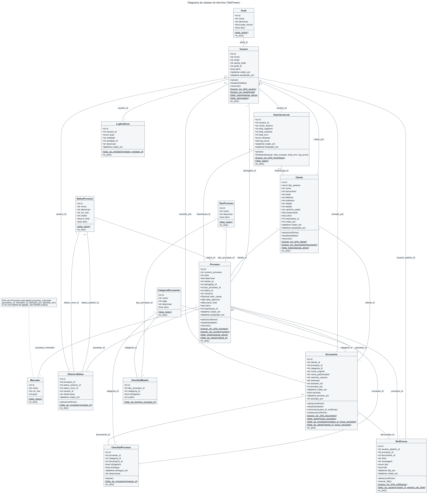
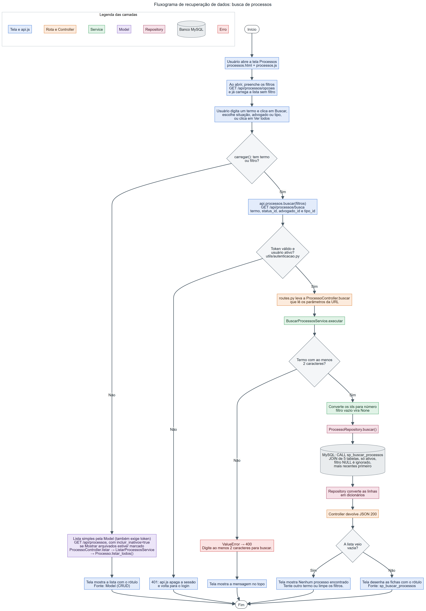
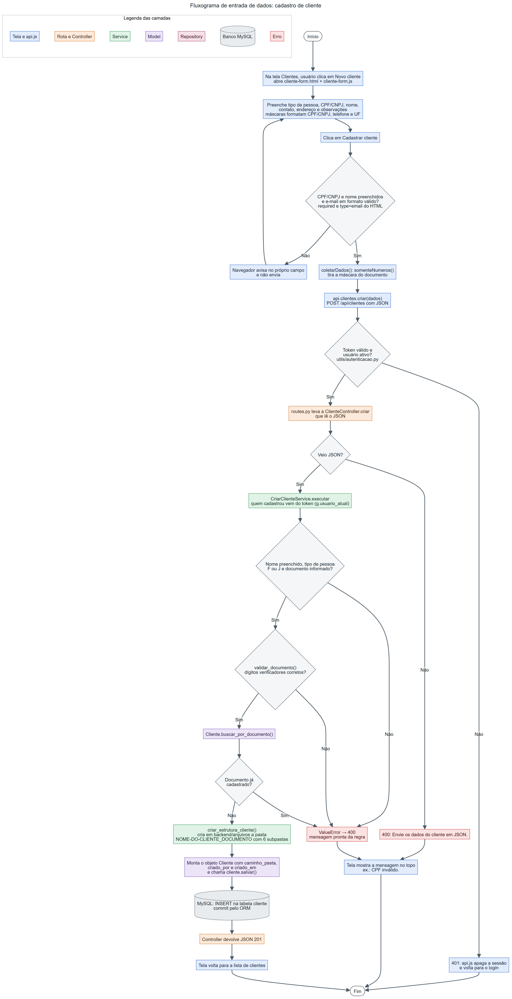

# TabFlower

Sistema de gestão de clientes, processos e documentos para escritórios de advocacia.

Projeto de Conclusão de Curso do Colégio COTEMIG, na disciplina Projeto de Software, com orientação do professor Gleison Brito. Equipe formada por Gabriel Mazzega, Gabriel Almeida, Gabriel Fernandes, Vitor Papini e Nnamdi Delfino.

## O problema

Num escritório de advocacia, a parte administrativa gasta horas com trabalho manual. Alguém cria uma pasta para cada cliente novo, renomeia um por um os PDFs escaneados, confere num papel quais documentos ainda faltam e mantém uma planilha paralela que nunca bate com o que está nas pastas.

O resultado é demora para achar arquivo, cadastro duplicado, documento perdido e ninguém sabendo dizer quem mexeu em quê. Esses problemas apareceram no formulário que aplicamos com profissionais da área antes de começar o projeto.

## O que o sistema faz

O TabFlower junta cliente, processo e documento num lugar só e tira das mãos do encarregado o trabalho repetitivo. Ele cria a pasta do cliente sozinho, renomeia os arquivos num padrão único, troca o checklist de papel por um digital, avisa o advogado quando chega documento novo e guarda quem fez cada ação importante.

Quem usa no dia a dia é o encarregado da parte administrativa, que no sistema tem o perfil Secretária. Os advogados são os responsáveis pelos processos e recebem os avisos. O administrador cadastra a equipe e é o único que pode excluir clientes, processos, documentos e usuários.

## Como o projeto é organizado

O frontend e a API são dois servidores separados. O frontend, feito em HTML, CSS e JavaScript puro, roda na porta 3000. A API, em Python com Flask, roda na porta 5000. Os dois só conversam por requisições HTTP com JSON, e toda chamada do frontend passa pelo arquivo `api.js`.

Dentro da API o código segue camadas, e cada uma tem a sua pasta.

1. A rota leva a requisição até o **Controller**, que lê o pedido, aciona a camada de baixo e devolve a resposta.
2. Em geral, o Controller chama o **Service** do caso de uso, que é onde ficam as regras. São 35 Services, separados por caso de uso.
3. Para salvar, atualizar ou buscar um registro simples, o Service usa a **Model**, que faz o CRUD pelo SQLAlchemy.
4. Para as consultas mais complexas, com várias junções, contagens e filtros combinados, o Service usa o **Repository**, que chama uma stored procedure no MySQL.

A conexão com o banco é um objeto único, criado no `extensions.py` e usado pelo projeto inteiro.

```
TabFlower/
├── backend/
│   ├── app.py, routes.py, run.py, config.py, extensions.py
│   ├── controllers/      9 Controllers
│   ├── services/         35 Services, separados por assunto
│   ├── repositories/     3 Repositories
│   ├── models/           15 Models
│   ├── utils/            login, validação de CPF e CNPJ, pastas e planilhas
│   └── database/         create_database.sql e procedures.sql
├── frontend/             14 páginas com os seus scripts, o api.js e o CSS
└── docs/                 diagrama de classes e fluxogramas
```

## Funcionalidades Implementadas

São 20 funcionalidades, todas funcionando de ponta a ponta, da tela até o banco. Embaixo de cada uma está o caminho que ela faz pelas camadas. Entre parênteses está a funcionalidade correspondente da proposta do projeto, e as 20 funcionalidades da proposta aparecem na lista.

### Primeiro grupo

1. **Entrar no sistema.** Confere o email e a senha e devolve um token assinado que vale 8 horas.\
   `AuthController → LoginService → Usuario`
2. **Cadastrar cliente.** Confere os dígitos do CPF ou CNPJ e barra documento repetido (funcionalidades 4 e 5).\
   `ClienteController → CriarClienteService → Cliente`
3. **Listar clientes.** Em ordem alfabética, com a opção de mostrar também os inativos.\
   `ClienteController → ListarClientesService → Cliente`
4. **Atualizar cliente.** Edita os dados cadastrais. O CPF ou CNPJ não muda depois do cadastro.\
   `ClienteController → AtualizarClienteService → Cliente`
5. **Excluir cliente.** Só o administrador exclui, e o cliente fica inativo em vez de sumir do banco.\
   `ClienteController → ExcluirClienteService → Cliente`
6. **Buscar cliente por nome ou documento.** O mesmo campo busca por parte do nome, numa stored procedure que também conta os processos de cada cliente, ou pelo CPF ou CNPJ completo (funcionalidades 1 e 2).\
   `ClienteController → BuscarClientesPorNomeService → ClienteRepository → sp_buscar_clientes_por_nome`\
   `ClienteController → BuscarClienteService → Cliente`
7. **Cadastrar usuário.** Só o administrador cadastra, e a senha é guardada como hash com sal.\
   `UsuarioController → CriarUsuarioService → Usuario`
8. **Cadastrar processo.** Abre a ação para um cliente e um advogado e já monta o checklist de documentos do tipo escolhido.\
   `ProcessoController → CriarProcessoService → Processo`
9. **Listar processos.** Os processos ativos, do mais novo para o mais antigo, com a opção de mostrar os arquivados.\
   `ProcessoController → ListarProcessosService → Processo`
10. **Painel de gestão.** Quantos processos há em cada fase, com os vencidos e os que vencem nos próximos 7 dias (funcionalidade 6).\
    `PainelController → ResumoPainelService → ProcessoRepository → sp_painel_resumo`

### Segundo grupo

11. **Configurar checklists.** Cada tipo de processo tem o seu molde de documentos exigidos, copiado para o processo quando ele é aberto (funcionalidade 13).\
    `ChecklistController → GerenciarModeloService → ChecklistModelo`
12. **Gerar a pasta do cliente.** No cadastro, o sistema cria a pasta do cliente no servidor com 6 subpastas (funcionalidade 8).\
    `CriarClienteService → gerenciador_arquivos.py`
13. **Checklist obrigatório e atualização de situação.** O processo nasce com o checklist do seu tipo. Se ele ainda está aguardando documentos e chega o último obrigatório, passa sozinho para “Pronto para protocolo”, com registro no histórico. A situação também pode ser mudada à mão (funcionalidades 7 e 11).\
    `EnviarDocumentoService → AvancarStatusAutomaticoService → AtualizarStatusService`\
    `ProcessoController → AtualizarStatusService → Processo e HistoricoStatus`
14. **Anexar documento com categoria e renomeação.** O arquivo ganha um nome no padrão SIGLA_NOME_DATA e vai para a subpasta da categoria (funcionalidades 9 e 10).\
    `DocumentoController → EnviarDocumentoService → Documento`
15. **Avisar o advogado responsável.** Cada documento anexado gera um aviso para o advogado do processo, e cada pessoa vê só os próprios avisos (funcionalidades 16 e 17).\
    `EnviarDocumentoService → Notificacao`\
    `NotificacaoController → NotificacaoRepository → sp_notificacoes_advogado`
16. **Mapear pendências.** O painel mostra o que ainda falta entregar em cada processo (funcionalidade 12).\
    `PainelController → PendenciasService → ProcessoRepository → sp_pendencias_checklist`
17. **Marcadores e filtro de prioridade.** Urgente, Prioridade e Prazo curto têm pesos diferentes, e o painel filtra os processos por eles (funcionalidades 14 e 15).\
    `PainelController → ProcessosPrioritariosService → ProcessoRepository → sp_processos_prioritarios`
18. **Busca avançada de processos.** Um termo procura ao mesmo tempo no número, no título e no nome do cliente, junto com filtros de situação, advogado e tipo (funcionalidade 3).\
    `ProcessoController → BuscarProcessosService → ProcessoRepository → sp_buscar_processos`
19. **Importar clientes de planilha.** Aceita CSV ou XLSX e aplica as mesmas regras do cadastro manual. O administrador pode desfazer um lote, e os clientes desse lote que já têm processo são preservados (funcionalidades 18 e 19).\
    `ImportacaoController → ImportarClientesService → CriarClienteService`
20. **Restringir e registrar exclusões.** Só o administrador exclui documentos, a exclusão é lógica, fica registrada no log de auditoria e o documento pode ser restaurado (funcionalidade 20).\
    `DocumentoController → ExcluirDocumentoService → Documento`\
    `ExcluirDocumentoService → RegistrarAuditoriaService → LogAuditoria`

## Models

São 15 Models, todas na pasta `models` e herdando de `db.Model`.

* Pessoas e acesso ficam em `Usuario`, `Perfil` e `Cliente`.
* Processos ficam em `Processo`, `HistoricoStatus`, `TipoProcesso`, `StatusProcesso` e `Marcador`.
* Documentos ficam em `Documento` e `CategoriaDocumento`.
* O checklist fica em `ChecklistModelo`, que é o molde por tipo, e `ChecklistProcesso`, que é a cópia de cada processo.
* Avisos, importação e auditoria ficam em `Notificacao`, `ImportacaoLote` e `LogAuditoria`.

## Banco de dados e Repositories

O banco `tabflower` tem 16 tabelas. A única sem Model é `processo_marcador`, que só liga processos e marcadores numa relação de muitos para muitos.

Nada importante é apagado de verdade. Cliente, processo e usuário ficam inativos, e o documento fica marcado como excluído, com quem excluiu e quando. Assim o histórico do escritório continua inteiro.

As consultas mais complexas ficam em 6 stored procedures, e só os 3 Repositories chamam essas procedures.

* `ClienteRepository` chama `sp_buscar_clientes_por_nome`, que busca por parte do nome e conta os processos de cada cliente.
* `ProcessoRepository` chama quatro procedures. A `sp_buscar_processos` junta 5 tabelas e combina o termo com os filtros. A `sp_painel_resumo` conta os processos de cada fase, com prazos vencidos e próximos. A `sp_pendencias_checklist` lista os documentos que faltam em cada processo. A `sp_processos_prioritarios` ordena os processos pelo peso dos marcadores e pelo prazo.
* `NotificacaoRepository` chama `sp_notificacoes_advogado`, que traz os avisos de quem está logado, com o processo, o cliente e o documento de cada um.

## Rotas da API

Todas as rotas respondem em JSON, menos o download de documento e o modelo de planilha, que devolvem arquivo. Só `/api/status` e `/api/auth/login` funcionam sem login.

* **Acesso** `GET /api/status`, `POST /api/auth/login` e `GET /api/usuarios/eu`
* **Clientes** `GET /api/clientes`, `GET /api/clientes/busca`, `GET /api/clientes/documento/<documento>`, `GET /api/clientes/<id>`, `POST /api/clientes`, `PUT /api/clientes/<id>` e `DELETE /api/clientes/<id>`
* **Processos** `GET /api/processos`, `GET /api/processos/opcoes`, `GET /api/processos/busca`, `GET /api/processos/numero`, `GET /api/processos/<id>`, `GET /api/processos/<id>/historico`, `GET /api/processos/<id>/checklist`, `POST /api/processos`, `PUT /api/processos/<id>`, `PATCH /api/processos/<id>/status` e `DELETE /api/processos/<id>`
* **Marcadores** `GET /api/processos/<id>/marcadores`, `POST /api/processos/<id>/marcadores` e `DELETE /api/processos/<id>/marcadores/<id_marcador>`
* **Documentos** `GET /api/documentos`, `GET /api/documentos/categorias`, `GET /api/documentos/<id>`, `GET /api/documentos/<id>/arquivo`, `POST /api/documentos`, `PUT /api/documentos/<id>`, `PATCH /api/documentos/<id>/restaurar` e `DELETE /api/documentos/<id>`
* **Usuários** `GET /api/usuarios`, `GET /api/usuarios/perfis`, `GET /api/usuarios/advogados`, `GET /api/usuarios/<id>`, `POST /api/usuarios`, `PUT /api/usuarios/<id>`, `PATCH /api/usuarios/<id>/senha` e `DELETE /api/usuarios/<id>`
* **Avisos** `GET /api/notificacoes` e `PATCH /api/notificacoes/<id>/lida`
* **Painel** `GET /api/painel/resumo`, `GET /api/painel/pendencias`, `GET /api/painel/prioritarios` e `GET /api/painel/marcadores`
* **Checklists** `GET /api/checklists/opcoes`, `GET /api/checklists`, `POST /api/checklists`, `PATCH /api/checklists/<id>/obrigatorio` e `DELETE /api/checklists/<id>`
* **Importação** `GET /api/importacoes`, `GET /api/importacoes/modelo`, `GET /api/importacoes/<id>/clientes`, `POST /api/importacoes` e `DELETE /api/importacoes/<id>`

## Diagramas

Os três diagramas ficam na pasta `docs` do repositório, nos arquivos `diagrama_classes.png`, `fluxograma_recuperacao.png` e `fluxograma_entrada.png`.

O diagrama de classes mostra as 15 classes do domínio, com atributos, métodos e relacionamentos.



O fluxograma de recuperação de dados acompanha uma busca de processos da tela até a stored procedure.



O fluxograma de entrada de dados acompanha o cadastro de um cliente da tela até o banco.



## Como rodar

Você vai precisar do Python 3.10 ou mais novo, do WAMP Server, do MySQL Workbench e do VS Code com a extensão Live Preview.

**1. Banco de dados.** Com o WAMP ligado, abra no MySQL Workbench o arquivo `backend/database/create_database.sql` e rode o script inteiro. Depois rode o `procedures.sql`, da mesma pasta. Se o banco `tabflower` já existir na sua máquina, não rode o `create_database.sql` de novo, porque ele apaga o banco e cria tudo do zero.

**2. Ambiente do backend.** No terminal, dentro da pasta `backend`, crie o ambiente virtual e instale as bibliotecas.

```
python -m venv venv
venv\Scripts\activate
pip install -r requirements.txt
```

Se o PowerShell disser que a execução de scripts está desabilitada, libere só para aquele terminal e rode o activate de novo.

```
Set-ExecutionPolicy -Scope Process -ExecutionPolicy Bypass
```

**3. Arquivo de configuração.** Copie o arquivo de exemplo e gere uma chave secreta própria. Cole a chave na linha `SECRET_KEY` do `.env`. Ela assina os tokens de login, então nunca deixe o valor de exemplo. No WAMP o usuário root normalmente não tem senha, e por isso a senha do banco fica vazia.

```
copy .env.example .env
python -c "import secrets; print(secrets.token_hex(32))"
```

**4. Primeiro usuário.** Só na primeira vez, crie o administrador. O script pede email, nome, perfil e senha. Escolha o perfil Admin.

```
python criar_primeiro_usuario.py
```

**5. API.** Suba a API e confira se ela está conectada ao banco abrindo o endereço de status no navegador.

```
python run.py
http://localhost:5000/api/status
```

**6. Frontend.** No VS Code, clique com o botão direito em `frontend/login.html` e escolha Show Preview. O Live Preview abre a tela na porta 3000, que é a liberada no CORS da API. Se usar outra ferramenta, como o Live Server, acrescente a porta dela na lista do `app.py`.

## Login e permissões

No login, a API devolve um token assinado com a chave secreta. O navegador guarda esse token e manda em todas as requisições seguintes. Nas rotas protegidas, antes de chegar ao Controller, a API confere o token e descobre quem está logado. Sem token válido, a resposta é 401. Ninguém consegue se passar por outra pessoa trocando um número no navegador, porque a API identifica o usuário pelo token, e não por um id enviado pela tela.

Cadastrar e editar clientes, processos e documentos é liberado para qualquer usuário logado, porque é o trabalho do dia a dia do encarregado. Excluir clientes, processos e documentos, restaurar documento, desfazer importação e cadastrar, editar ou desativar usuários fica só com o administrador. Os botões aparecem para todos, e quem não tem permissão recebe uma resposta 403 com uma frase explicando a regra.

## Limitações conhecidas

O login atende o escopo do projeto, mas não tem tudo o que um sistema em produção teria. Sair apaga o token só no navegador, e não existe bloqueio depois de várias senhas erradas.

A validação de CPF e CNPJ confere os dígitos verificadores, mas não consulta a Receita Federal.

O envio de arquivos é validado pela extensão e pelo tamanho, não pelo conteúdo.

O log de auditoria registra logins, exclusões e restaurações. Cadastros e edições ainda não entram nele.
